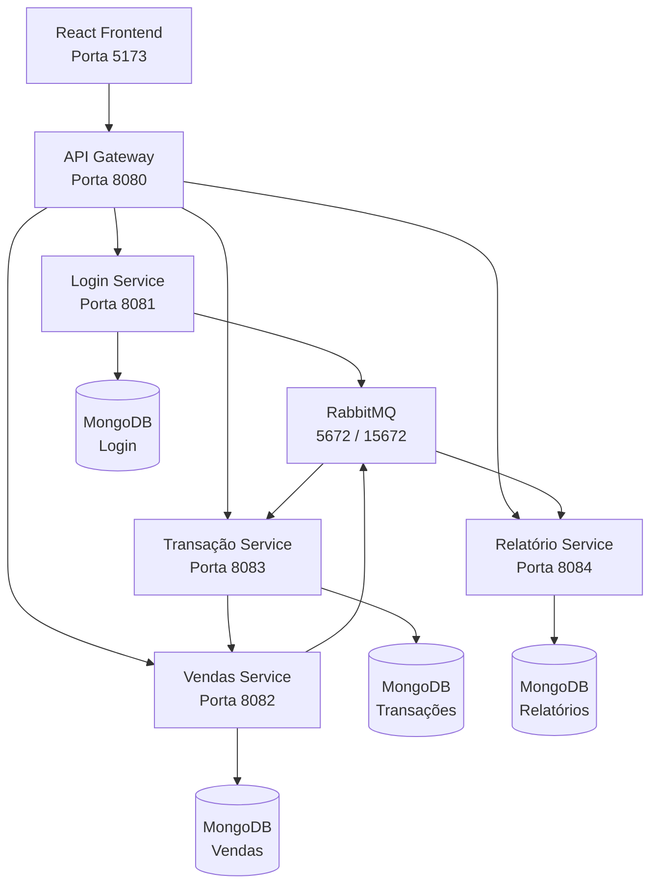
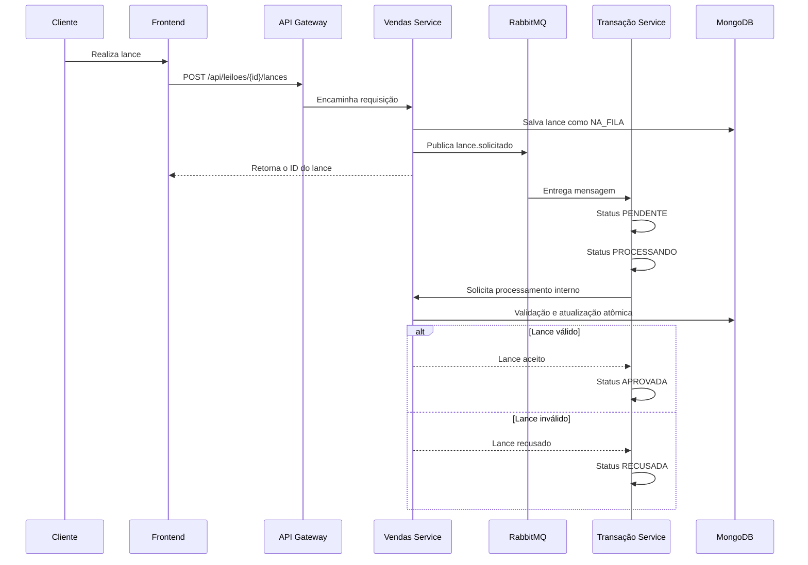

# 💄 Beauty Bid

Plataforma de leilões de produtos de beleza desenvolvida com **arquitetura de microsserviços**, processamento assíncrono com **RabbitMQ**, autenticação com **JWT**, persistência em **MongoDB** e interface web em **React**.

O Beauty Bid permite que clientes participem de leilões, realizem lances e acompanhem seus resultados, enquanto administradores podem gerenciar usuários, leilões e visualizar relatórios da plataforma.

---

## 👩‍💻 Equipe

- **Mariana Akemi**
- **Giovana Marsigli**

---

## 📌 Sobre o projeto

O **Beauty Bid** é uma plataforma de leilões voltada para produtos de maquiagem e beleza.

A aplicação foi desenvolvida utilizando uma arquitetura distribuída, separando responsabilidades em diferentes microsserviços.

O sistema possui dois tipos principais de usuário:

### 👤 Cliente

O cliente pode:

- Criar uma conta
- Realizar login
- Visualizar os leilões disponíveis
- Consultar detalhes de um produto
- Realizar lances
- Acompanhar o processamento do lance
- Visualizar seus próprios lances
- Saber quando está liderando um leilão
- Visualizar leilões vencidos

### 👑 Administrador

O administrador pode:

- Criar leilões
- Editar leilões
- Excluir leilões
- Visualizar os leilões cadastrados
- Gerenciar usuários
- Editar usuários
- Excluir usuários
- Visualizar indicadores da plataforma
- Consultar o histórico de eventos
- Acompanhar transações aprovadas e recusadas

---

# 🏗️ Arquitetura

O projeto utiliza uma arquitetura baseada em microsserviços.



---

# 🧩 Microsserviços

## 🔐 Login Service

Responsável por:

- Cadastro de usuários
- Autenticação
- Geração de JWT
- Controle dos perfis `CLIENTE` e `ADM`
- CRUD administrativo de usuários
- Publicação de eventos relacionados aos usuários

Porta:

```text
8081
```

Banco:

```text
MongoDB - login_db
```

---

## 🌐 API Gateway

Responsável por centralizar as requisições realizadas pelo frontend.

O frontend não acessa diretamente os microsserviços.

O Gateway é responsável por:

- Roteamento das requisições
- Validação do JWT
- Controle de autenticação
- Controle de autorização por perfil
- Proteção das rotas administrativas
- Inclusão de informações do usuário autenticado nos headers internos

Porta:

```text
8080
```

---

## 🛍️ Vendas Service

Responsável pelos leilões e lances.

Funcionalidades:

- CRUD de leilões
- Solicitação de lances
- Armazenamento dos lances
- Atualização do maior lance
- Controle do vencedor atual
- Encerramento automático dos leilões
- Validação atômica do valor do lance
- Controle de concorrência
- Retry de conflitos transacionais

Porta:

```text
8082
```

Banco:

```text
MongoDB - vendas_db
```

---

## 💳 Transação Service

Responsável por processar os lances recebidos de forma assíncrona.

Estados utilizados durante o processamento:

```text
PENDENTE
   ↓
PROCESSANDO
   ↓
APROVADA / RECUSADA / ERRO
```

Também mantém um histórico dos estados de cada transação.

Porta:

```text
8083
```

Banco:

```text
MongoDB - transacao_db
```

---

## 📊 Relatório Service

Responsável por consumir os eventos da plataforma através do RabbitMQ.

Os eventos são armazenados para geração de indicadores como:

- Quantidade de leilões criados
- Quantidade de leilões encerrados
- Quantidade de lances recebidos
- Transações aprovadas
- Transações recusadas
- Usuários criados
- Valor total vendido
- Histórico de eventos

Porta:

```text
8084
```

Banco:

```text
MongoDB - relatorio_db
```

---

# 🐇 RabbitMQ

O projeto utiliza **RabbitMQ** para comunicação assíncrona entre os serviços.

Exchange principal:

```text
leilao.events
```

Entre os eventos utilizados estão:

```text
lance.solicitado
transacao.pendente
transacao.processando
transacao.aprovada
transacao.recusada
leilao.criado
leilao.atualizado
leilao.encerrado
usuario.criado
```

O `relatorio-service` recebe os eventos da plataforma e os armazena para geração dos relatórios.

---

# 💸 Fluxo de um lance

Quando um cliente realiza um lance:



---

# ⚡ Controle de concorrência

Um dos pontos importantes do projeto é o tratamento de **lances simultâneos**.

Durante os testes foram enviados dois lances praticamente no mesmo instante:

```text
Mariana → R$ 250,00
Ana     → R$ 260,00
```

As duas requisições foram enviadas simultaneamente.

O MongoDB detectou uma disputa de escrita entre as transações:

```text
WriteConflict
TransientTransactionError
```

Para lidar com esse cenário foi utilizado:

```text
Spring Retry
```

junto às transações do MongoDB.

O fluxo passou a funcionar da seguinte maneira:

```text
Lances simultâneos
        ↓
RabbitMQ
        ↓
Múltiplos consumidores
        ↓
MongoDB detecta WriteConflict
        ↓
Rollback da tentativa
        ↓
Spring Retry
        ↓
Nova transação
        ↓
Regra do lance é reavaliada
        ↓
Maior lance permanece vencedor
```

Resultado do teste:

```text
Mariana → R$ 250,00 → APROVADA
Ana     → R$ 260,00 → APROVADA

Valor final: R$ 260,00
Vencedora: Ana
```

Dessa forma, mesmo com requisições concorrentes, um lance de menor valor não sobrescreve um lance superior.

---

# 🔄 Transações

O projeto utiliza transações de banco de dados em mais de um microsserviço.

### Vendas Service

Utiliza:

```java
@Transactional
```

durante o processamento de um lance.

A alteração do leilão também utiliza uma operação atômica com:

```text
findAndModify
```

---

### Transação Service

Utiliza transações para garantir consistência entre:

```text
Transação
+
Histórico de status
```

Os bancos utilizados nesses serviços executam como **Replica Sets do MongoDB**, permitindo o uso de transações.

---

# ⏱️ Encerramento automático

Os leilões são encerrados automaticamente quando atingem sua data limite.

O `vendas-service` possui um Scheduler que verifica periodicamente os leilões expirados.

Fluxo:

```text
Leilão ABERTO
     ↓
Horário limite atingido
     ↓
Scheduler detecta expiração
     ↓
Status = ENCERRADO
     ↓
Evento publicado no RabbitMQ
     ↓
Relatório recebe evento
```

O valor final do leilão passa a fazer parte do indicador de **valor total vendido**.

---

# 🔐 Segurança

A autenticação da aplicação utiliza:

```text
JWT - JSON Web Token
```

O token é armazenado em um cookie:

```text
AUTH_TOKEN
```

com a configuração:

```text
HttpOnly
SameSite=Lax
```

Os principais perfis são:

```text
CLIENTE
ADM
```

Exemplos de autorização:

```text
CLIENTE → /leiloes
CLIENTE → /meus-lances

ADM → /admin
ADM → /admin/usuarios
ADM → /admin/relatorios
```

Caso um `CLIENTE` tente acessar uma rota administrativa, ele é redirecionado para a área de leilões.

As rotas internas entre microsserviços não são expostas pelo API Gateway.

---

# 📊 Dashboard administrativo

O painel administrativo apresenta indicadores como:

```text
Leilões criados
Leilões encerrados
Lances recebidos
Transações aprovadas
Transações recusadas
Usuários criados
Valor total vendido
```

Também existe uma página de relatórios com o histórico dos eventos recebidos através do RabbitMQ.

---

# 💻 Tecnologias utilizadas

## Backend

- Java
- Spring Boot
- Spring Web
- Spring Data MongoDB
- Spring Cloud Gateway
- Spring AMQP
- Spring Retry
- Spring AOP
- Spring Scheduling
- JWT
- Maven

## Frontend

- React
- JavaScript
- Vite
- React Router
- CSS

## Infraestrutura

- MongoDB
- MongoDB Replica Set
- RabbitMQ
- Docker
- Docker Compose

## Controle de versão

- Git
- GitHub

---

# 🌐 Portas utilizadas

| Serviço | Porta |
|---|---:|
| API Gateway | `8080` |
| Login Service | `8081` |
| Vendas Service | `8082` |
| Transação Service | `8083` |
| Relatório Service | `8084` |
| Frontend | `5173` |
| RabbitMQ | `5672` |
| RabbitMQ Management | `15672` |
| Mongo Login | `27017` |
| Mongo Vendas | `27018` |
| Mongo Transação | `27019` |
| Mongo Relatório | `27020` |

---

# 📁 Estrutura do projeto

```text
Beauty-Bid/
│
├── api-gateway/
│   └── api-gateway/
│
├── login-service/
│   └── login-service/
│
├── vendas-service/
│   └── vendas-service/
│
├── transacao-service/
│   └── transacao-service/
│
├── relatorio-service/
│   └── relatorio-service/
│
├── frontend/
│
├── scripts/
│   └── teste-concorrencia.ps1
│
├── docker-compose.yml
├── .gitignore
└── README.md
```

---

# ▶️ Como executar o projeto

## Pré-requisitos

Antes de iniciar, instale:

```text
Java 17+
Node.js 20+
Docker
Docker Compose
Git
```

---

## 1. Clonar o repositório

```bash
git clone https://github.com/marianafeitosa/Beauty-Bid.git
```

Entre na pasta:

```bash
cd Beauty-Bid
```

---

## 2. Iniciar a infraestrutura

Na raiz do projeto:

```bash
docker compose up -d
```

Isso inicia:

```text
RabbitMQ
Mongo Login
Mongo Vendas
Mongo Transação
Mongo Relatório
```

---

## 3. Iniciar o Login Service

Windows:

```bash
cd login-service/login-service
.\mvnw.cmd spring-boot:run
```

---

## 4. Iniciar o API Gateway

Em outro terminal:

```bash
cd api-gateway/api-gateway
.\mvnw.cmd spring-boot:run
```

---

## 5. Iniciar o Vendas Service

```bash
cd vendas-service/vendas-service
.\mvnw.cmd spring-boot:run
```

---

## 6. Iniciar o Transação Service

```bash
cd transacao-service/transacao-service
.\mvnw.cmd spring-boot:run
```

---

## 7. Iniciar o Relatório Service

```bash
cd relatorio-service/relatorio-service
.\mvnw.cmd spring-boot:run
```

---

## 8. Iniciar o frontend

```bash
cd frontend
npm install
npm run dev
```

Acesse:

```text
http://localhost:5173
```

---

# 🐇 RabbitMQ Management

O painel administrativo do RabbitMQ pode ser acessado em:

```text
http://localhost:15672
```

Ambiente local padrão:

```text
Usuário: guest
Senha: guest
```

---

# 🧪 Teste de concorrência

O projeto possui um script para testar dois lances simultaneamente.

Arquivo:

```text
scripts/teste-concorrencia.ps1
```

No Windows PowerShell:

```powershell
powershell -ExecutionPolicy Bypass -File .\scripts\teste-concorrencia.ps1
```

O teste dispara dois lances praticamente ao mesmo tempo e permite validar o controle de concorrência.

---

# 📡 Principais endpoints

## Autenticação

```text
POST /api/auth/register
POST /api/auth/login
POST /api/auth/logout
GET  /api/auth/me
```

## Usuários

```text
GET    /api/auth/usuarios
GET    /api/auth/usuarios/{id}
PUT    /api/auth/usuarios/{id}
DELETE /api/auth/usuarios/{id}
```

Rotas administrativas.

---

## Leilões

```text
GET    /api/leiloes
GET    /api/leiloes/{id}
POST   /api/leiloes
PUT    /api/leiloes/{id}
DELETE /api/leiloes/{id}
```

---

## Lances

```text
POST /api/leiloes/{id}/lances
GET  /api/leiloes/lances/meus
```

---

## Transações

```text
GET /api/transacoes/lance/{lanceId}
GET /api/transacoes/lance/{lanceId}/historico
```

---

## Relatórios

```text
GET /api/relatorios/resumo
GET /api/relatorios/eventos
```

---

# ✅ Requisitos implementados

- [x] Arquitetura de microsserviços
- [x] API Gateway
- [x] Frontend React
- [x] Autenticação JWT
- [x] Perfis CLIENTE e ADM
- [x] CRUD de usuários
- [x] CRUD de leilões
- [x] Sistema de lances
- [x] RabbitMQ
- [x] Comunicação assíncrona
- [x] Histórico de transações
- [x] MongoDB
- [x] Transações em múltiplos microsserviços
- [x] Controle de concorrência
- [x] Retry de conflitos transacionais
- [x] Múltiplos consumidores
- [x] Encerramento automático de leilões
- [x] Relatórios
- [x] Histórico de eventos
- [x] Dashboard administrativo
- [x] Área Meus Lances
- [x] Controle de acesso por perfil

---

# 📸 Interface

O Beauty Bid possui uma interface própria para clientes e administradores.

Principais telas:

- Login e cadastro
- Listagem de leilões
- Detalhes do leilão
- Realização de lance
- Meus Lances
- Dashboard administrativo
- Cadastro de leilões
- Edição de leilões
- Gerenciamento de usuários
- Relatórios
- Histórico de eventos

---

# 🚀 Possíveis evoluções

Como melhorias futuras, o projeto pode receber:

- Deploy em ambiente cloud
- Recuperação de senha
- Notificações em tempo real
- WebSocket para atualização instantânea dos valores
- Upload próprio de imagens
- Paginação dos leilões
- Busca e filtros
- Testes automatizados de integração
- Pipeline de CI/CD

---

# 👩‍💻 Desenvolvido por

**Mariana Akemi**  
**Giovana Marsigli**

Projeto acadêmico desenvolvido utilizando conceitos de:

```text
Microsserviços
Mensageria
APIs REST
Autenticação
Transações
Concorrência
Banco de dados NoSQL
Desenvolvimento Frontend
```

💄 **Beauty Bid — dê seu melhor lance.**